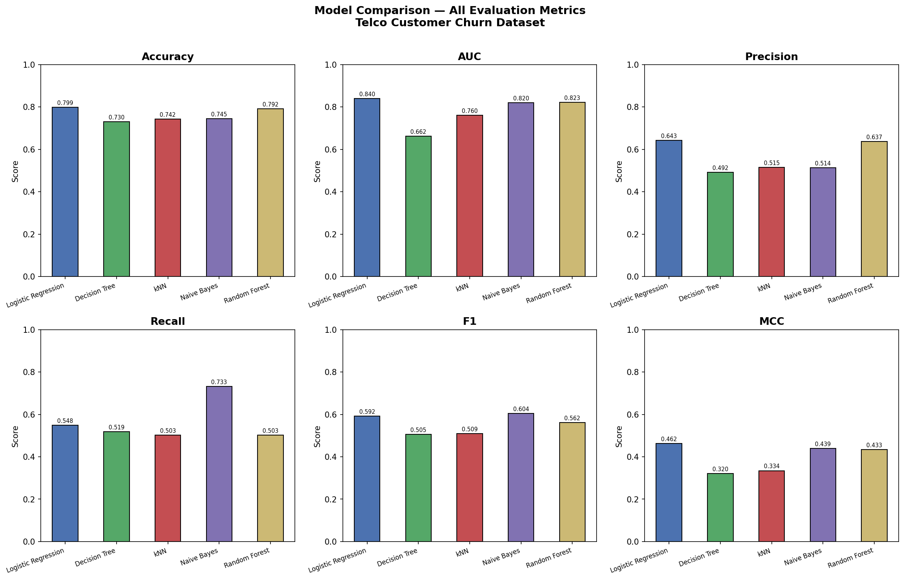
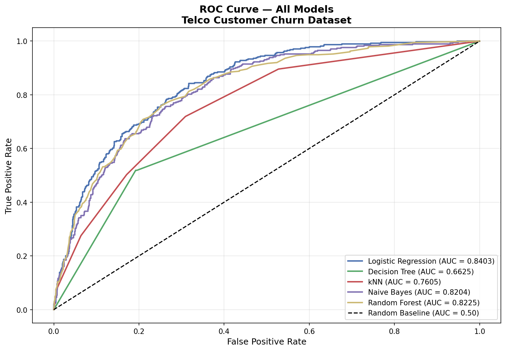

# ML Assignment 2 — Classification Models on Telco Customer Churn Dataset

**Student:** Maada | BITS ID: 2026CT05112  
**Course:** Machine Learning | BITS Pilani WILP M.Tech (AIML) 2024–26  
**Submission Date:** 27 November 2026  
**Dataset:** [Telco Customer Churn — IBM Watson Analytics](https://www.kaggle.com/datasets/blastchar/telco-customer-churn)

---

## Problem Statement

Predict whether a telecom customer will churn (leave the service) based on their account information, demographics, and usage patterns. This is a **binary classification** problem with the target variable `Churn` (Yes = 1, No = 0).

The business motivation is straightforward: retaining an existing customer costs significantly less than acquiring a new one. A model that accurately predicts churn enables the company to intervene proactively — offering targeted discounts or service improvements to at-risk customers before they leave.

---

## Why This Dataset?

| Criterion | Detail |
|---|---|
| Instance count | 7,043 rows — above the 5,000 minimum threshold |
| Feature count | 21 columns → 19 usable features after dropping ID and encoding target |
| Real missing values | 11 blank strings in `TotalCharges` — requires explicit handling |
| Class imbalance | 73.5% No Churn / 26.5% Churn — a realistic and challenging split |
| Mix of feature types | Numerical, binary categorical, and multi-class categorical columns |
| Domain relevance | Churn prediction is a canonical ML use case in telecommunications |

The dataset satisfies every requirement in the assignment specification: realistic size, real-world origin, natural class imbalance, missing values requiring handling, and a mix of feature types that tests different preprocessing decisions.

---

## Dataset Description

| Property | Detail |
|---|---|
| Source | Kaggle / IBM Watson Analytics Sample Dataset |
| Instances | 7,043 rows |
| Features | 21 columns (20 after dropping customerID) |
| Target Variable | `Churn` (Yes = 1, No = 0) |
| Class Distribution | No Churn: 73.5% (5,174) / Churn: 26.5% (1,869) |
| Missing Values | 11 (TotalCharges column — blank strings converted to NaN) |
| Duplicates | 0 |

**Feature Types:**

| Type | Columns |
|---|---|
| Numerical | `tenure`, `MonthlyCharges`, `TotalCharges`, `SeniorCitizen` |
| Categorical (Binary) | `gender`, `Partner`, `Dependents`, `PhoneService`, `PaperlessBilling`, `Churn` |
| Categorical (Multi-class) | `MultipleLines`, `InternetService`, `OnlineSecurity`, `OnlineBackup`, `DeviceProtection`, `TechSupport`, `StreamingTV`, `StreamingMovies`, `Contract`, `PaymentMethod` |

> **Note:** `SeniorCitizen` is already stored as int64 (0/1) in the original IBM dataset — it was not encoded by us.

---

## Data Preprocessing

Preprocessing follows a strict, leakage-free pipeline applied in this order:

| Step | Action | Rationale |
|---|---|---|
| 1. Missing Values | `TotalCharges` had 11 blank strings → `pd.to_numeric(errors='coerce')` → filled with **median (1397.47)** | Right-skewed billing data — median is more representative than mean |
| 2. Duplicates | Checked — 0 duplicates found across all 7,043 rows | Duplicates would bias training toward repeated records |
| 3. Drop customerID | Removed — unique identifier with no predictive value | String ID cannot encode meaningful information for ML |
| 4. Encode Binary Columns | `Yes/No/Male/Female` → direct 0/1 mapping | Avoids creating unnecessary ordinal structure |
| 5. Encode Multi-category Columns | `LabelEncoder` applied to 10 columns | Converts string categories to numeric codes for sklearn |
| 6. Train-Test Split | 80:20, `stratify=y`, `random_state=42` | Stratification preserves the 73.5/26.5 class ratio in both splits |
| 7. Feature Scaling | `StandardScaler` fitted **only on training data**, applied (transform-only) to test | Prevents data leakage — test statistics must not influence the scaler |
| 8. Scaling Scope | Applied only to LR and kNN inputs | DT, NB, RF are scale-invariant — no scaling needed |

---

## Models Used

Five classification algorithms were implemented, each chosen to represent a distinct family of ML approaches:

### Model Configurations

| Model | Algorithm Family | Key Parameters | Scaled Data? |
|---|---|---|---|
| Logistic Regression | Linear / Probabilistic | `max_iter=1000`, `random_state=42` | ✅ Yes |
| Decision Tree | Tree-based | `random_state=42`, no depth limit | ❌ No |
| k-Nearest Neighbors (kNN) | Instance-based | `n_neighbors=5` | ✅ Yes |
| Gaussian Naive Bayes | Probabilistic / Bayesian | Default GaussianNB | ❌ No |
| Random Forest | Ensemble (Bagging) | `n_estimators=100`, `random_state=42` | ❌ No |

**Scaling rationale:** Logistic Regression and kNN are sensitive to feature magnitude — LR uses gradient descent on the loss surface, kNN uses Euclidean distance — so they receive StandardScaler-transformed data. Decision Tree, Naive Bayes, and Random Forest split on thresholds or probabilities and are invariant to scale, so raw (unscaled) data is passed to them.

---

## Evaluation Metrics

Six metrics were computed for every model using `sklearn.metrics` — no values are hardcoded:

| Metric | Formula | Interpretation |
|---|---|---|
| **Accuracy** | (TP + TN) / (TP + TN + FP + FN) | Overall fraction of correct predictions |
| **AUC** | Area under the ROC curve | Probability that model ranks a random churner above a non-churner; threshold-independent |
| **Precision** | TP / (TP + FP) | Of all predicted churners, how many actually churned (avoid false alarms) |
| **Recall** | TP / (TP + FN) | Of all actual churners, how many were caught (avoid missing real churners) |
| **F1 Score** | 2 × (Precision × Recall) / (Precision + Recall) | Harmonic mean — balances Precision and Recall |
| **MCC** | (TP×TN − FP×FN) / √((TP+FP)(TP+FN)(TN+FP)(TN+FN)) | Balanced metric even on class-imbalanced datasets; ranges from −1 to +1 |

MCC is particularly important here because of the 73.5/26.5 class imbalance — it accounts for all four quadrants of the confusion matrix and cannot be gamed by a model that predicts the majority class.

---

## Results

### Comparative Metrics Table

| ML Model | Accuracy | AUC | Precision | Recall | F1 | MCC |
|---|---|---|---|---|---|---|
| Logistic Regression | **0.7991** | **0.8403** | **0.6426** | 0.5481 | **0.5916** | **0.4621** |
| Decision Tree | 0.7303 | 0.6625 | 0.4924 | 0.5187 | 0.5052 | 0.3202 |
| kNN | 0.7424 | 0.7605 | 0.5151 | 0.5027 | 0.5088 | 0.3343 |
| Naive Bayes | 0.7452 | 0.8204 | 0.5141 | **0.7326** | 0.6042 | 0.4392 |
| Random Forest | 0.7921 | 0.8225 | 0.6373 | 0.5027 | 0.5620 | 0.4334 |

> **Bold** = best in that metric column.

---

## Graph Representations

### Summary Metrics Table — All 5 Models × 6 Metrics


A colour-coded table rendered within the notebook. Green cells mark the best-performing model per metric; red cells mark the worst. At a glance: Logistic Regression dominates most columns, while Decision Tree consistently appears in red.

### Model Comparison — All 6 Metrics


Six bar charts arranged in a 2×3 grid — one per metric. Each chart shows all five models side by side, making it easy to compare relative performance within each metric. Logistic Regression leads in Accuracy, AUC, Precision, and MCC. Naive Bayes is visually the standout in Recall.

### Confusion Matrices — All 5 Models


A 2×3 grid of confusion matrices (one per model, sixth cell hidden). Each matrix shows four quadrants: True Negatives (top-left), False Positives (top-right), False Negatives (bottom-left), True Positives (bottom-right). Key observation: Naive Bayes has the highest True Positives (actual churners correctly identified) but also the most False Positives. Logistic Regression and Random Forest show a tighter balance.

### ROC Curve — All 5 Models


All five ROC curves plotted on one chart against the random baseline (diagonal dashed line). The vertical axis is True Positive Rate (Recall); horizontal axis is False Positive Rate (1 − Specificity). AUC values in the legend confirm Logistic Regression (0.8403) curves furthest left and highest — closest to the ideal top-left corner. Decision Tree (0.6625) barely separates from the baseline.

### Feature Importance — Random Forest


A horizontal bar chart ranking all 19 features by their importance score from the trained Random Forest. The top three features — TotalCharges (0.187), MonthlyCharges (0.179), and tenure (0.154) — together account for over 52% of predictive power. This aligns with intuition: how much a customer pays and how long they have been a customer are the strongest signals of whether they will leave.

---

## Model Observations

| ML Model | Observation |
|---|---|
| **Logistic Regression** | Best overall performer — highest Accuracy (0.7991) and AUC (0.8403). Strong probabilistic discrimination. Lower Recall (0.5481) means it misses ~45% of actual churners — a concern where catching churners early is the priority. Recommended as the default production model. |
| **Decision Tree** | Weakest performer overall — lowest AUC (0.6625) and MCC (0.3202). Without depth limiting, the tree overfits training data. Its discrimination ability is significantly lower than ensemble and linear models. Useful for interpretability but not for accuracy. |
| **kNN** | Mid-range across all metrics. Recall (0.5027) is lowest among all models. Performance is constrained by high dimensionality (19 features) — with k=5, it struggles to generalize in high-dimensional space (curse of dimensionality). |
| **Naive Bayes** | Surprisingly good AUC (0.8204) despite the naive independence assumption. Standout Recall (0.7326) — catches 73% of actual churners, highest among all models. Low Precision (0.5141) means higher false alarms. Best choice if business priority is flagging maximum potential churners. |
| **Random Forest** | Well-balanced and second-strongest model — Accuracy (0.7921) and AUC (0.8225) close to Logistic Regression. Top features: TotalCharges, MonthlyCharges, tenure. Ensemble voting reduces the overfitting seen in the single Decision Tree. |

### Overall Winner

**Logistic Regression** is the best model by Accuracy, AUC, Precision, F1, and MCC.  
**Naive Bayes** is preferred if the business goal is maximising churn detection (highest Recall).

---

## Key Technical Notes

- **No hardcoding:** All metric values are computed dynamically using `sklearn.metrics` functions applied to live model predictions.
- **Data leakage prevention:** `StandardScaler` is fitted exclusively on training data (`fit_transform`), then applied to test data with `transform` only.
- **Class imbalance handling:** `stratify=y` in `train_test_split` ensures both train and test sets maintain the original 73.5/26.5 distribution.
- **Median imputation:** Used for `TotalCharges` (11 missing values) because billing data is right-skewed — the mean is pulled upward by high-value customers, making median a more representative fill value.
- **Model persistence:** All five models saved as `.joblib` files alongside the notebook for independent reloading without retraining.

---

## Repository Structure

```
ml-assignment-2/
├── model/
│   ├── ml_classification.ipynb      # Main notebook — all 5 models, preprocessing, graphs
│   ├── logistic_regression.joblib   # Saved Logistic Regression model
│   ├── decision_tree.joblib         # Saved Decision Tree model
│   ├── knn.joblib                   # Saved kNN model
│   ├── gaussian_nb.joblib           # Saved Gaussian Naive Bayes model
│   └── random_forest.joblib         # Saved Random Forest model
├── results/
│   ├── summary_table.png            # Colour-coded metrics table (all 5 models × 6 metrics)
│   ├── model_comparison.png         # 6-panel bar chart comparison
│   ├── confusion_matrices.png       # 5 confusion matrices in one figure
│   ├── roc_curve.png                # ROC curves — all 5 models overlaid
│   └── feature_importance.png       # Random Forest feature ranking
├── requirements.txt                 # Python dependencies
├── test_data.csv                    # 100-row test sample with actual Churn labels
└── README.md                        # This file
```

---

## How to Run

### Option A — Google Colab (Recommended)

1. Open `model/ml_classification.ipynb` in [Google Colab](https://colab.research.google.com/)
2. Run Cell 1 — a **file upload dialog appears automatically**
3. Select `WA_Fn-UseC_-Telco-Customer-Churn.csv` from your computer
4. Run all remaining cells: **Runtime → Run all** (Ctrl+F9)
5. All outputs, charts, and saved `.joblib` files are generated automatically

> **No Google Drive mounting required.**

### Option B — Local Jupyter

1. Install dependencies:
   ```bash
   pip install pandas numpy scikit-learn matplotlib joblib notebook
   ```
2. Place `WA_Fn-UseC_-Telco-Customer-Churn.csv` in the `model/` folder (same directory as the notebook)
3. Launch Jupyter:
   ```bash
   jupyter notebook model/ml_classification.ipynb
   ```
4. Run all cells: **Cell → Run All**

### Dataset Download

Freely available on Kaggle:  
https://www.kaggle.com/datasets/blastchar/telco-customer-churn  
Filename: `WA_Fn-UseC_-Telco-Customer-Churn.csv`

---

## Requirements

```
pandas
numpy
scikit-learn
matplotlib
joblib
```

```bash
pip install pandas numpy scikit-learn matplotlib joblib
```

---

## Execution Evidence

The notebook was executed end-to-end on the **BITS Prayogshala Virtual Lab** (g3.prayogshala.bits-pilani.ac.in) using Google Colab. Screenshots of the execution environment are included in the submitted PDF report.
