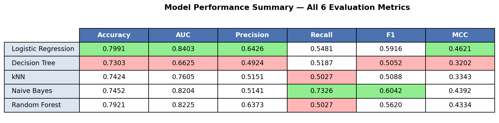
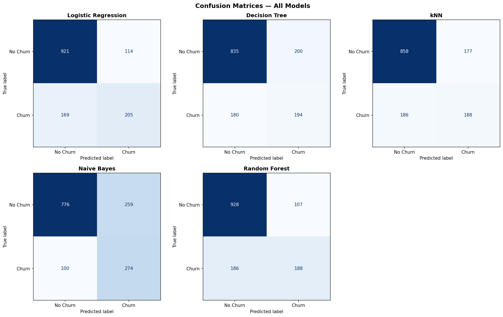
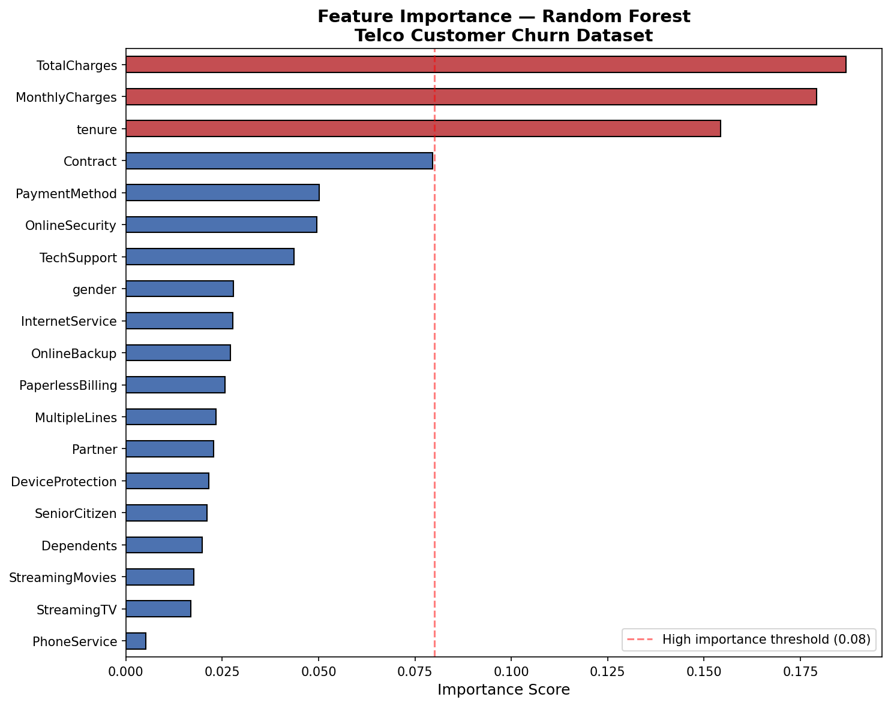

# ml-assignment-2
ML Assignment 2 - Classification Models on Telco Churn Dataset

# ML Assignment 2 — Classification Models on Telco Customer Churn Dataset

**Course:** Machine Learning | BITS Pilani WILP M.Tech (AIML) 2024–26  
**Dataset:** [Telco Customer Churn — IBM Watson Analytics](https://www.kaggle.com/datasets/blastchar/telco-customer-churn)

---

## Problem Statement

Predict whether a telecom customer will churn (leave the service) based on their account information, demographics, and usage patterns. This is a binary classification problem with the target variable `Churn` (Yes = 1, No = 0).

---

## Dataset Description

| Property | Detail |
|---|---|
| Source | Kaggle / IBM Watson Analytics Sample Dataset |
| Instances | 7,043 rows |
| Features | 21 columns (20 after dropping customerID) |
| Target Variable | Churn (Yes = 1, No = 0) |
| Class Distribution | No Churn: 73.5% / Churn: 26.5% |
| Missing Values | 11 (TotalCharges column — blank strings converted to NaN) |
| Duplicates | 0 |

**Why this dataset?**  
The Telco Churn dataset satisfies all assignment requirements: 20+ features, 7000+ instances, real missing values requiring handling, and natural class imbalance that must be examined.

**Feature Types:**
- Numerical: `tenure`, `MonthlyCharges`, `TotalCharges`, `SeniorCitizen`
- Categorical (Binary): `gender`, `Partner`, `Dependents`, `PhoneService`, `PaperlessBilling`, `Churn`
- Categorical (Multi-class): `MultipleLines`, `InternetService`, `OnlineSecurity`, `OnlineBackup`, `DeviceProtection`, `TechSupport`, `StreamingTV`, `StreamingMovies`, `Contract`, `PaymentMethod`

---

## GitHub Repository Link

https://github.com/2026ct05112/ml-assignment-2

Repository contains:
- `model/ml_classification.ipynb` — Complete notebook with all 5 models
- `model/*.joblib` — Saved trained model files (one per classifier)
- `results/` — All visualisation charts
- `requirements.txt` — Python dependencies
- `test_data.csv` — 100-row test sample with actual Churn labels

---

## Data Preprocessing

| Step | Action |
|---|---|
| Missing Values | `TotalCharges` had 11 blank strings → converted to NaN via `pd.to_numeric(errors='coerce')` → filled with **median (1397.47)** |
| Duplicates | Checked — 0 duplicates found |
| Feature Dropped | `customerID` — unique identifier with no predictive value |
| Encoding | Binary columns → direct 0/1 mapping; Multi-category columns → LabelEncoder |
| Train-Test Split | 80:20, `stratify=y`, `random_state=42` |
| Class Balance | Both train and test maintain 73.5% / 26.5% ratio |
| Feature Scaling | StandardScaler fitted **only on training data**, applied to test (prevents data leakage) |
| Scaling Applied To | LR and kNN (distance/linear sensitive); DT, NB, RF use unscaled data |

---

## Models Used

### Model Configurations

| Model | Key Parameters |
|---|---|
| Logistic Regression | `max_iter=1000`, `random_state=42`, scaled data |
| Decision Tree | `random_state=42`, unscaled data, no depth limit |
| kNN | `n_neighbors=5`, scaled data |
| Naive Bayes | GaussianNB, unscaled data |
| Random Forest | `n_estimators=100`, `random_state=42`, unscaled data |

### Evaluation Metrics

| ML Model Name | Accuracy | AUC | Precision | Recall | F1 | MCC |
|---|---|---|---|---|---|---|
| Logistic Regression | 0.7991 | 0.8403 | 0.6426 | 0.5481 | 0.5916 | 0.4621 |
| Decision Tree | 0.7303 | 0.6625 | 0.4924 | 0.5187 | 0.5052 | 0.3202 |
| kNN | 0.7424 | 0.7605 | 0.5151 | 0.5027 | 0.5088 | 0.3343 |
| Naive Bayes | 0.7452 | 0.8204 | 0.5141 | 0.7326 | 0.6042 | 0.4392 |
| Random Forest | 0.7921 | 0.8225 | 0.6373 | 0.5027 | 0.5620 | 0.4334 |

### Graph Representation

#### Summary Metrics Table — All 5 Models × 6 Metrics


#### Model Comparison — All 6 Metrics


#### Confusion Matrices — All 5 Models


#### ROC Curve — All 5 Models


#### Feature Importance — Random Forest


---

## Observations

| ML Model Name | Observation about model performance |
|---|---|
| Logistic Regression | Best overall performer — highest Accuracy (0.7991) and AUC (0.8403). Strong at distinguishing churners probabilistically. Lower Recall (0.5481) means it misses ~45% of actual churners — a concern where catching churners early is valuable. |
| Decision Tree | Weakest performer overall — lowest AUC (0.6625) and MCC (0.3202). Without depth limiting, the tree overfits training data. Its discrimination ability is significantly lower than ensemble and linear models. |
| kNN | Mid-range performer across all metrics. Recall (0.5027) is lowest among all models. Performance constrained by high dimensionality (19 features) — with k=5, it struggles to generalize in high-dimensional space. |
| Naive Bayes | Surprisingly good AUC (0.8204) despite the naive independence assumption. Standout Recall (0.7326) — catches 73% of actual churners, highest among all models. Low Precision (0.5141) means higher false alarms. Best choice if business priority is flagging maximum potential churners. |
| Random Forest | Well-balanced model — second highest Accuracy (0.7921) and AUC (0.8225). Top features: TotalCharges (0.187), MonthlyCharges (0.179), tenure (0.154). Reduces overfitting seen in Decision Tree through ensemble voting. |
| **Overall Winner** | **Logistic Regression** — highest Accuracy and AUC with good balance of Precision and F1. If the goal is maximising churn detection (Recall), Naive Bayes is preferred. |

---

## Key Observations

- **SeniorCitizen** is stored as int64 (0/1) in the original dataset — it was not encoded by us but was already numeric. This is a known characteristic of the IBM Telco dataset.
- **No duplicates** were found — all 7,043 rows are unique customer records.
- **Class imbalance** (73.5% No Churn vs 26.5% Churn) was preserved using `stratify=y` during train-test split.
- **Median imputation** was used for TotalCharges (11 missing values) because billing data is right-skewed — the mean is pulled upward by high-value customers, making median a more representative fill value.
- **Data leakage prevention**: StandardScaler fitted only on training data and applied (transform-only) to test data.

---

## Execution Instructions

1. Open `model/ml_classification.ipynb` in Google Colab
2. Mount Google Drive and update the CSV path in Cell 1 to your Drive location
3. Run all cells in order (Runtime → Run all)
4. All outputs, charts, and saved files generate automatically

**Install dependencies:**
```
pip install pandas numpy scikit-learn matplotlib joblib
```

---

## Screenshot

*(Screenshot of execution on BITS Virtual Lab — see submitted PDF)*
